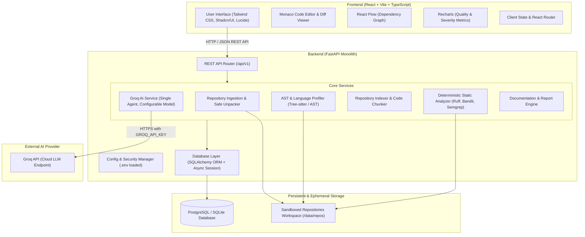
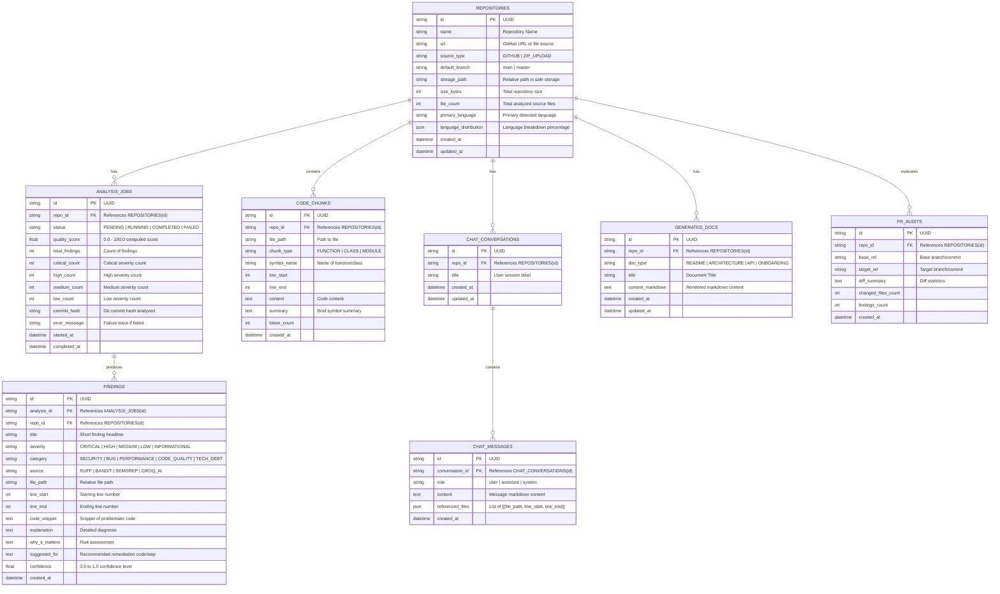
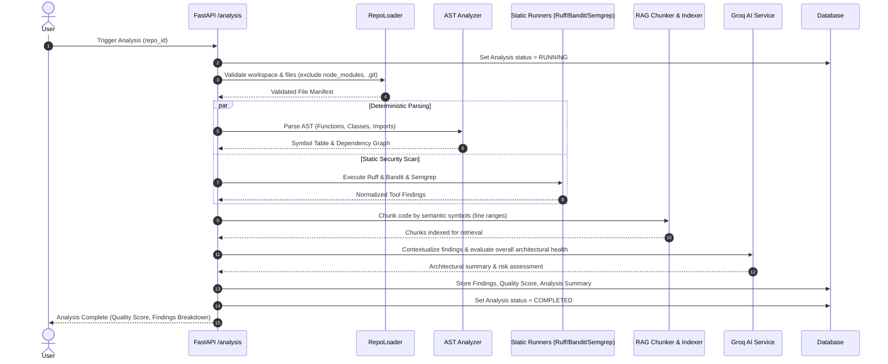

# Bugveil — Architecture & Engineering Specification

## 1. System Architecture

Bugveil is structured as a **modular monolith** with clear separation of concerns, strict boundary interfaces, and low cognitive overhead.



### Architectural Principles:
1. **Separation of Determinism and Heuristics**: Static analyzers (Ruff, Bandit, Semgrep) provide deterministic ground truths; the Groq AI agent provides contextual reasoning, impact analysis, code explanations, and syntheses. AI never fabricates static tool findings.
2. **Zero Code Execution**: Uploaded or cloned code is strictly analyzed statically via AST and regex/tokenizers. Sandboxed workspace paths are isolated; scripts are never run.
3. **Single AI Agent Service**: One centralized, reusable AI service client calling Groq. No multi-agent fragmentation or multiple LLM providers.
4. **Resilient Degradation**: If `GROQ_API_KEY` is not present, the application remains fully functional for repository browsing, AST parsing, and deterministic static analysis, displaying a clear configuration warning for AI-specific endpoints.

---

## 2. Folder Structure

```
prompt_final_project/
├── .gitignore
├── README.md
├── docs/
│   └── ARCHITECTURE.md
├── backend/
│   ├── .env.example
│   ├── requirements.txt
│   ├── pyproject.toml
│   └── app/
│       ├── __init__.py
│       ├── main.py                    # FastAPI entrypoint & middleware
│       ├── core/
│       │   ├── __init__.py
│       │   ├── config.py              # Environment settings (Pydantic Settings)
│       │   ├── database.py            # SQLAlchemy async engine & session
│       │   ├── security.py            # Safe path checks & sanitizers
│       │   └── exceptions.py          # Custom API exception handlers
│       ├── models/                    # SQLAlchemy database models
│       │   ├── __init__.py
│       │   ├── repository.py
│       │   ├── analysis.py
│       │   ├── finding.py
│       │   ├── chat.py
│       │   └── documentation.py
│       ├── schemas/                   # Pydantic request/response schemas
│       │   ├── __init__.py
│       │   ├── common.py
│       │   ├── repository.py
│       │   ├── analysis.py
│       │   ├── finding.py
│       │   ├── chat.py
│       │   └── documentation.py
│       ├── services/                  # Business logic & external tool integrations
│       │   ├── __init__.py
│       │   ├── repo_loader.py         # Git clone & ZIP safe extractor
│       │   ├── ast_analyzer.py        # Tree-sitter & AST symbol extraction
│       │   ├── static_analyzer/       # Deterministic analyzers
│       │   │   ├── __init__.py
│       │   │   ├── runner.py
│       │   │   ├── ruff_adapter.py
│       │   │   ├── bandit_adapter.py
│       │   │   └── semgrep_adapter.py
│       │   ├── rag_engine/            # Retrieval Augmented Generation engine
│       │   │   ├── __init__.py
│       │   │   ├── chunker.py
│       │   │   ├── indexer.py
│       │   │   └── retriever.py
│       │   ├── ai_service.py          # Groq API integration (Single Agent)
│       │   └── report_generator.py    # Audit report builder
│       └── api/
│           ├── __init__.py
│           └── v1/
│               ├── __init__.py
│               ├── router.py
│               └── endpoints/
│                   ├── health.py
│                   ├── repositories.py
│                   ├── analysis.py
│                   ├── explorer.py
│                   ├── pull_requests.py
│                   ├── static_analysis.py
│                   ├── chat.py
│                   ├── documentation.py
│                   ├── dependencies.py
│                   ├── reports.py
│                   └── settings.py
└── frontend/
    ├── .env.example
    ├── package.json
    ├── tsconfig.json
    ├── vite.config.ts
    ├── tailwind.config.js
    ├── postcss.config.js
    ├── index.html
    └── src/
        ├── index.css
        ├── main.tsx
        ├── App.tsx
        ├── types/
        │   └── index.ts
        ├── services/
        │   ├── api.ts
        │   └── client.ts
        ├── components/
        │   ├── layout/
        │   │   ├── Sidebar.tsx
        │   │   ├── Navbar.tsx
        │   │   └── DashboardLayout.tsx
        │   ├── ui/
        │   │   ├── Button.tsx
        │   │   ├── Badge.tsx
        │   │   ├── Card.tsx
        │   │   ├── Modal.tsx
        │   │   └── StatusIndicator.tsx
        │   └── common/
        │       ├── EmptyState.tsx
        │       ├── MetricCard.tsx
        │       └── SeverityTag.tsx
        └── pages/
            ├── DashboardPage.tsx
            ├── RepositoriesPage.tsx
            ├── RepositoryImportPage.tsx
            ├── RepositoryOverviewPage.tsx
            ├── FileExplorerPage.tsx
            ├── CodeExplanationPage.tsx
            ├── PullRequestPage.tsx
            ├── AuditResultsPage.tsx
            ├── SecurityFindingsPage.tsx
            ├── DocumentationPage.tsx
            ├── DependencyGraphPage.tsx
            ├── ChatbotPage.tsx
            ├── ReportsPage.tsx
            └── SettingsPage.tsx
```

---

## 3. Database Schema

The database tracks repositories, analysis runs, static and AI findings, code chunks for RAG, conversation history, and generated documentation.



---

## 4. API Endpoint Plan

All endpoints are prefixed with `/api/v1`.

| Method | Endpoint | Description |
|---|---|---|
| `GET` | `/health` | Backend status, DB connectivity, Groq config status |
| `GET` | `/dashboard/summary` | Global counts (repos, findings, severity totals) |
| `POST` | `/repositories/import-url` | Clone public GitHub repo safely |
| `POST` | `/repositories/upload-zip` | Upload & extract ZIP with path sanitization |
| `GET` | `/repositories` | List all tracked repositories |
| `GET` | `/repositories/{id}` | Get repository details & metadata |
| `DELETE` | `/repositories/{id}` | Delete repository and workspace files |
| `POST` | `/repositories/{id}/analyze` | Trigger full repository analysis pipeline |
| `GET` | `/analysis/{id}/status` | Check ongoing analysis progress |
| `GET` | `/analysis/{id}/findings` | Retrieve filtered findings (by severity, file) |
| `GET` | `/repositories/{id}/files` | Retrieve hierarchical file tree |
| `GET` | `/repositories/{id}/file-content` | Fetch source code content of a specific file |
| `POST` | `/explorer/explain` | AI explanation of file, class, or function |
| `POST` | `/pull-requests/audit` | Compare two branches/commits with AI & diff |
| `POST` | `/static-analysis/run` | Run Ruff, Bandit, and Semgrep directly |
| `POST` | `/chat/conversations` | Create new repository chat session |
| `GET` | `/chat/{conversation_id}/history`| Retrieve chat messages |
| `POST` | `/chat/{conversation_id}/message`| Send query to Bugveil Assistant (RAG) |
| `POST` | `/documentation/generate` | Generate README, Architecture, or API docs |
| `GET` | `/documentation/{repo_id}` | Retrieve generated documentation files |
| `GET` | `/dependencies/{repo_id}` | Retrieve AST dependency graph nodes & edges |
| `GET` | `/reports/{repo_id}` | Generate downloadable audit report JSON / Markdown |
| `GET` | `/settings/config` | Read non-sensitive system environment status |

---

## 5. Repository Analysis Pipeline



---

## 6. AI Integration Design (Groq Single Agent)

- **Single Provider**: Groq Cloud API exclusively.
- **Configurable Model**: Driven via `GROQ_MODEL` environment variable (e.g. `llama-3.3-70b-versatile` or `llama-3.1-8b-instant`).
- **Encapsulated Client**: One centralized `GroqService` class handling all prompt templates, schema enforcement, rate-limit retries, and error handling.
- **Structured Outputs**: All analysis and review tasks enforce valid JSON schemas via Pydantic response models.
- **Safe Fallback**: If `GROQ_API_KEY` is unset or invalid:
  - System logs an explicit configuration warning.
  - Returns `424 Failed Dependency` or structured error: `"Groq API key not configured. Please set GROQ_API_KEY in your backend .env file."`
  - Prevents crashes; deterministic static analysis and repository browsing continue working seamlessly.

---

## 7. Chatbot Retrieval Architecture (Bugveil Assistant)

The assistant uses an AST-aware semantic retrieval pipeline:
1. **Symbol-Aware Chunking**: Rather than arbitrary character slicing, code is partitioned by class, function, or module boundaries with exact file paths and line ranges (`start_line`, `end_line`).
2. **Inverted Index & BM25 / Vector Search**: Queries are matched against symbol names, docstrings, imports, and code text.
3. **Prompt Grounding**: The top matching code snippets (with explicit file path and line numbers) are injected into the system prompt.
4. **Anti-Hallucination Constraints**: The system prompt strictly prohibits fabricating code or files not present in the context; if ambiguous, it replies: *"I could not find reference to this in the indexed repository."*

---

## 8. Security Plan

| Threat Vector | Mitigation Strategy |
|---|---|
| **Path Traversal / Zip Slip** | Safe extraction checking `os.path.commonpath([target_dir, extracted_path]) == target_dir`. Reject any entry containing `..`. |
| **Malicious Repository Execution** | Zero dynamic execution. Source files are strictly read as plain text or parsed via AST/Tree-sitter. No build scripts or interpreters are ever invoked on target code. |
| **ZIP Bombs & Excessive Files** | Strict limits: Max ZIP size = 50 MB; Max uncompressed size = 150 MB; Max file count = 2,500; Max individual file size = 2 MB. |
| **SSRF (Server-Side Request Forgery)** | Validates clone URLs against strict regex `https://github.com/[\w-]+/[\w.-]+`. Disallows `localhost`, private IP ranges (`10.0.0.0/8`, `172.16.0.0/12`, `192.168.0.0/16`, `169.254.169.254`), file schemes, or SSH. |
| **API Key Exposure** | Keys reside solely on backend via environment variables. Excluded in `.gitignore`, substituted with placeholders in `.env.example`, stripped from client responses and logs. |
| **Data Privacy** | Informs users with a UI disclaimer prior to transmitting source code chunks to the Groq API. |

---

## 9. Milestone Roadmap

- **Milestone 1**: Project setup, complete architecture, backend & frontend foundation, dark SaaS UI, sidebar navigation, responsive layout, realistic empty-state dashboard, and live backend connectivity. (Completed)
- **Milestone 2**: Repository Ingestion & File Processing (GitHub clone, safe ZIP extraction, Zip-Slip & bomb defense, language profiling, hierarchical file tree, and code viewer). (Completed)
- **Milestone 3**: Deterministic Static Analysis Engine (Ruff, Bandit, Semgrep, and Polyglot Security Scanner with normalized findings and offline quality scoring). (Completed)
- **Milestone 4**: Single Groq AI Service (Code Explainer, Bug Analysis, Security Contextualizer, PR Auditor, Doc Generator, Test Generator). (Completed)
- **Milestone 5**: AST Parsing & Symbol Extraction (Functions, Classes, Imports). (Next)
- **Milestone 6**: Bugveil Assistant RAG Chatbot (AST chunking, retrieval, grounded responses). (Scheduled)
- **Milestone 7**: Dependency Graph & Blast Radius Visualization (Tree-sitter/AST import parser + React Flow). (Scheduled)
- **Milestone 8**: Comprehensive Audit Report download (PDF/Markdown), end-to-end testing, security hardening, and deployment guidelines. (Scheduled)
- **Milestone 9**: Dependency Graph Visualization (Tree-sitter/AST import parser + React Flow). (Scheduled)
- **Milestone 10**: Comprehensive Audit Report download (PDF/Markdown), end-to-end testing, security hardening, and deployment guidelines. (Scheduled)

---

## 10. Environment Configuration Plan

### Backend Configuration (`backend/.env.example`)
```env
# Application
PROJECT_NAME="Bugveil"
ENVIRONMENT="development"
DEBUG=true
PORT=8000
HOST="127.0.0.1"

# Database (SQLite by default for zero-setup local dev, PostgreSQL for production)
DATABASE_URL="sqlite+aiosqlite:///./bugveil.db"

# Groq AI Provider (Required for AI analysis & Chat)
GROQ_API_KEY=your_groq_api_key_here
GROQ_MODEL=llama-3.3-70b-versatile

# Storage
STORAGE_DIR="./data/storage"
MAX_UPLOAD_SIZE_MB=50
```

### Frontend Configuration (`frontend/.env.example`)
```env
VITE_API_BASE_URL="http://127.0.0.1:8000/api/v1"
```
